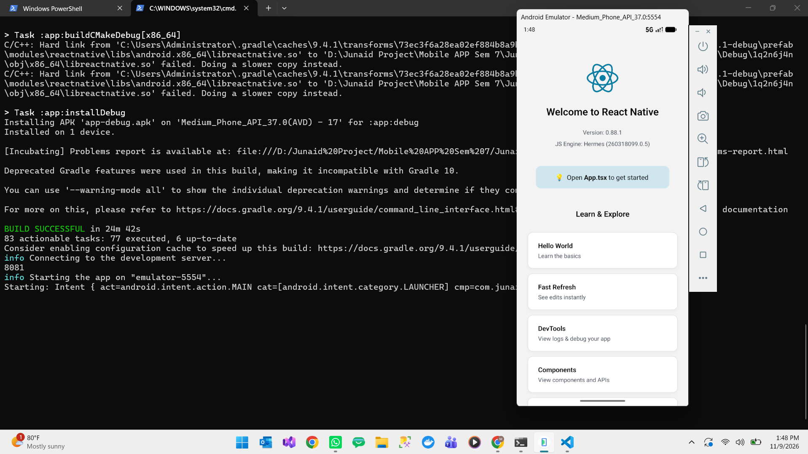
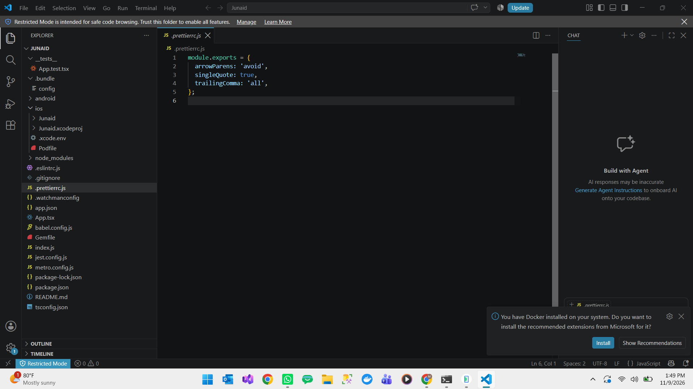

# Mobile Application Development - Assignment 1

## **Name:** Muhammad Junaid

## **ID:*** F2023266884

## **Course:** Mobile Application Development

## **Instructor:** M. Shahbaz Ali

## **University:** University of Management and Technology (UMT)

## React Native Setup Proof

This repository contains proof that a React Native project was created and run successfully on the Android Emulator.

### 1. App running on the Android Emulator

### 2. Project file structure in VS Code

